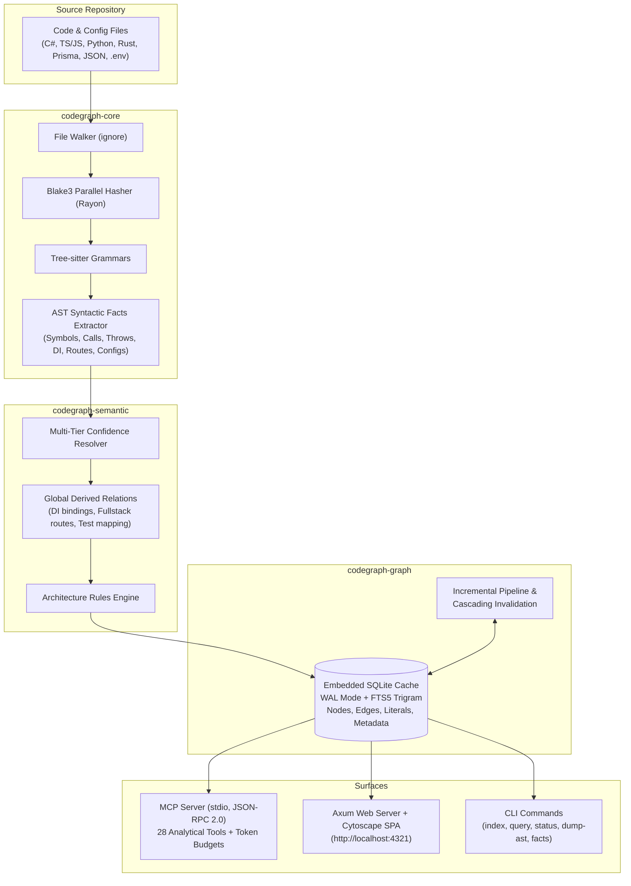

<p align="center">
  
</p>

# CodeGraph

<p align="center">
  <strong>Deep Semantic Code Indexer & MCP Server for AI Coding Agents</strong><br>
  High-performance knowledge graph engine with formal confidence levels, zero external runtime dependencies, and an embedded interactive visual graph explorer.
</p>

<p align="center">
  <a href="https://github.com/codegraph/codegraph/actions"></a>
  <a href="LICENSE"></a>
  <a href="https://www.rust-lang.org/"></a>
  <a href="https://modelcontextprotocol.io/"></a>
  <a href="#performance--benchmarks"></a>
  <a href="#single-binary-zero-dependencies"></a>
</p>

---

## Table of Contents

- [Overview](#overview)
- [Key Features](#key-features)
- [System Architecture](#system-architecture)
- [Quick Start](#quick-start)
- [Connecting to AI Coding Agents (MCP)](#connecting-to-ai-coding-agents-mcp)
  - [Claude Code](#claude-code)
  - [Claude Desktop / Cursor / Antigravity](#claude-desktop--cursor--antigravity)
  - [Codex](#codex)
  - [Windsurf & VS Code Extensions](#windsurf--vs-code-extensions)
- [Agent Skills (Claude Code, Codex, Antigravity)](#agent-skills-claude-code-codex-antigravity)
- [Confidence Levels & Evidence Tracing](#confidence-levels--evidence-tracing)
- [MCP Toolset (28 Analytical Tools)](#mcp-toolset-28-analytical-tools)
- [Interactive Graph Explorer (`codegraph ui`)](#interactive-graph-explorer-codegraph-ui)
- [Architecture Governance & Boundary Enforcement](#architecture-governance--boundary-enforcement)
- [Supported Languages & Ecosystems](#supported-languages--ecosystems)
- [CLI Reference](#cli-reference)
- [Performance & Benchmarks](#performance--benchmarks)
- [Incremental Indexing Engine](#incremental-indexing-engine)
- [Testing & Quality Assurance](#testing--quality-assurance)
- [Contributing](#contributing)
- [License](#license)

---

## Overview

Modern AI coding assistants (Claude Code, Cursor, Copilot, Antigravity, Roo Code) struggle on medium-to-large codebases when relying solely on lexical search (grep) or flat vector embeddings (RAG). Vector search misses structural relationships like dependency injection, inheritance, cross-boundary HTTP contracts, and call hierarchies, while wasting thousands of tokens on irrelevant context.

**CodeGraph** solves this by parsing your repository into a **deep semantic knowledge graph** stored in an embedded SQLite database (`WAL` mode + `FTS5` trigram tokenization). Every relationship is assigned a **formal confidence level** backed by concrete source evidence.

CodeGraph exposes this graph through three interfaces:
1. **MCP Server** (JSON-RPC 2.0 over `stdio`): 28 high-precision analytical tools with strict token budget controls (`max_token_budget`) and automatic freshness verification.
2. **Interactive Visual Explorer** (`http://localhost:4321`): Embedded Axum web server and Cytoscape.js SPA with dark/light themes, keyboard navigation, and multilingual support (English, Portuguese, Spanish).
3. **Command-Line Interface (CLI)**: Fast commands for indexing, querying, inspecting AST facts, and checking architectural boundaries.

All of this ships in a **single standalone binary (~20 MB)** with **zero external runtime dependencies**: Tree-sitter parsers, SQLite with FTS5, and the web UI are compiled directly into the executable.

---

## Key Features

- **Single Self-Contained Binary**: No Node.js runtime, Python environment, or external database required.
- **Multi-Level Confidence System**: Distinguishes between verifiable relationships (`exact`), structural heuristics (`inferred`), and ambiguous dynamic calls (`unresolved`).
- **Targeted Freshness Engine**: Monitors filesystem changes via background OS notifications (`notify`). Re-indexes modified files and referenced symbols before answering tool calls, guaranteeing fresh answers without stale cache hallucinations.
- **Token-Budget Friendly**: Every MCP tool enforces an optional `max_token_budget`. If truncated, responses provide an explicit summary marker:  
  `[TRUNCATED: Showing 4 of 19 results to fit 150 token budget (142 tokens used)]`.
- **Cross-Framework & Fullstack Tracing**: Unifies frontend API calls (Axios, Fetch, TanStack Query) with backend routes (ASP.NET Core, NestJS, FastAPI), Dependency Injection containers (.NET DI, NestJS `@Injectable`, FastAPI `Depends`), and ORM entities (EF Core, Prisma, TypeORM, SQLAlchemy, Django, Pydantic).
- **Specialized Unity Engine Support**: Seamlessly parses Unity C# projects by neutralizing conditional preprocessor branches (`#if UNITY_EDITOR`), detecting Unity event messages (`Awake`, `Start`, `Update`), attribute hooks (`[MenuItem]`, `[InitializeOnLoadMethod]`), storage mutations (`PlayerPrefs`, `EditorPrefs`), and web requests (`UnityWebRequest`).
- **Architectural Linting & Governance**: Enforces module and layer separation boundaries declared in `.codegraph/architecture.toml` or falls back to standard Clean Architecture conventions.

---

## System Architecture



---

## Quick Start

### 1. Build from Source

```bash
git clone https://github.com/codegraph/codegraph.git
cd codegraph
cargo build --release
```
The compiled binary will be located at `./target/release/codegraph` (or `codegraph.exe` on Windows).

### 2. Index a Repository

```bash
# Indexes into <project-path>/.codegraph/graph.db
./target/release/codegraph index /path/to/your/project
```
> [!NOTE]
> CodeGraph automatically adds `.codegraph/` to the project's `.gitignore`.

### 3. Launch the Graph Explorer

```bash
./target/release/codegraph ui /path/to/your/project
```
Opens `http://localhost:4321` in your default browser with an interactive graph, symbol inspector, and query palette.

### 4. Execute a Direct Query via CLI

```bash
./target/release/codegraph query search_universal \
  --root /path/to/your/project \
  --args '{"query":"OrderService"}'
```

`query` indexes the project on first use and re-indexes changed files before answering, so it is safe to call right after editing code.

> [!IMPORTANT]
> Windows PowerShell 5.1 strips the inner double quotes from arguments passed to native executables. Escape them there: `--args '{\"query\":\"OrderService\"}'`. Bash, Git Bash and PowerShell 7.3+ accept the plain form.

---

## Connecting to AI Coding Agents (MCP)

CodeGraph implements the **Model Context Protocol (MCP)** specification over `stdio`. It can be plugged into any MCP-compatible client.

### Claude Code

Add CodeGraph directly using the Claude CLI:

```bash
claude mcp add codegraph -- /path/to/codegraph mcp --root /path/to/your/project
```

### Claude Desktop / Cursor / Antigravity

Add CodeGraph to your client's configuration file (`claude_desktop_config.json`, `.cursor/mcp.json`, or Antigravity MCP settings):

```json
{
  "mcpServers": {
    "codegraph": {
      "command": "/usr/local/bin/codegraph",
      "args": ["mcp", "--root", "/path/to/your/project"]
    }
  }
}
```

On **Windows**:
```json
{
  "mcpServers": {
    "codegraph": {
      "command": "C:/tools/codegraph.exe",
      "args": ["mcp", "--root", "D:/repos/my-application"]
    }
  }
}
```

### Codex

Add the server to `~/.codex/config.toml`:

```toml
[mcp_servers.codegraph]
command = "/usr/local/bin/codegraph"   # e.g. 'C:\tools\codegraph.exe' on Windows
args = ["mcp", "--root", "/path/to/your/project"]
```

### Windsurf & VS Code Extensions

For extensions supporting MCP servers over standard input/output (e.g. Continue, Roo Code, Cline):

```json
{
  "name": "codegraph",
  "command": "codegraph",
  "args": ["mcp"],
  "env": {
    "CODEGRAPH_ROOT": "${workspaceFolder}",
    "CODEGRAPH_LOG": "warn"
  }
}
```

> [!TIP]
> If `--root` is omitted from `args`, CodeGraph checks the `CODEGRAPH_ROOT` environment variable and falls back to the current working directory. Logs are written exclusively to `stderr` (`CODEGRAPH_LOG=debug` or `warn`), leaving `stdout` clean for JSON-RPC messages.

---

## Agent Skills (Claude Code, Codex, Antigravity)

An MCP server makes the tools available; a skill teaches the agent **when** to reach for them. [`skills/codegraph/SKILL.md`](skills/codegraph/SKILL.md) tells the agent to read supported files through the graph instead of opening them whole:

1. Map the file with `get_file_outline` / `get_file_skeleton`.
2. Read only the symbols it needs with `get_symbol_body`.
3. Follow callers, types, DI, routes and tests through the graph instead of grep.
4. Before editing, read just the line range the outline reported.

It falls back to normal reading for unsupported files (Markdown, YAML, `.d.ts`, `.min.js`, assets…), small files, and answers that look wrong. The skill uses the MCP tools when the server is registered and the `codegraph query` CLI otherwise, so it also works with no MCP setup.

Install it by copying the folder into the agent's skills directory:

| Agent | Skills directory |
|---|---|
| Claude Code | `~/.claude/skills/codegraph/` (or `<project>/.claude/skills/codegraph/` for one repo) |
| Codex | `~/.codex/skills/codegraph/` |
| Antigravity | `~/.gemini/config/skills/codegraph/` |

```bash
cp -r skills/codegraph ~/.claude/skills/
cp -r skills/codegraph ~/.codex/skills/
cp -r skills/codegraph ~/.gemini/config/skills/
```

If `codegraph` isn't on your `PATH`, edit the **Binary** line in the copied `SKILL.md` to point at your executable.

---

## Confidence Levels & Evidence Tracing

Unlike tools that rely on guessing, every edge in CodeGraph carries an explicit confidence level and a traceable evidence description:

| Confidence | Description | Evidence Example |
|---|---|---|
| `exact` | Statically guaranteed by AST structure, direct imports, typed receivers, enclosing scopes, or explicit DI registrations. | `DI scoped registration IOrderService -> OrderService in Program.cs:12` |
| `inferred` | Resolved via high-confidence structural conventions, matching HTTP route contracts across services, or unique matching symbol implementations. | `route match 'POST /api/orders/${id}/cancel' <-> POST /api/Orders/{id}/cancel` |
| `unresolved` | Ambiguous or dynamic call sites. Retains the symbol reference (`unresolved_symbol`) and enumerates possible targets without hallucinating links. | `3 potential implementations of IHandler.Execute` |

Compact tool output notation:
```text
src/auth.ts:10 AuthStore.login -> src/utils/hash.ts:3 hash [exact: direct import from './hash']
```

---

## MCP Toolset (28 Analytical Tools)

CodeGraph equips AI agents with 28 specialized analytical tools designed to minimize context window consumption while delivering comprehensive architectural insights:

```
┌────────────────────────────────────────────────────────────────────────┐
│                        CodeGraph Tool Matrix                           │
├───────────────────────┬────────────────────────┬───────────────────────┤
│ 1. Token Economy      │ 2. Discovery           │ 3. Navigation         │
│  • batch_query        │  • search_universal    │  • trace_execution    │
│  • get_file_skeleton  │  • find_literal        │  • trace_fullstack    │
│  • get_structural_diff│  • find_variable_const │  • resolve_di         │
│  • simulate_signature │                        │  • get_call_hierarchy │
│  • get_flow_diagram   │                        │  • get_type_hierarchy │
│                       │                        │  • get_impact_radius  │
├───────────────────────┼────────────────────────┼───────────────────────┤
│ 4. Behavior & State   │ 5. Data & Extraction   │ 6. Governance & Git   │
│  • get_state_mutations│  • get_data_model      │  • get_complexity     │
│  • trace_error_flow   │  • get_config_matrix   │  • validate_rules     │
│  • find_by_capability │  • get_type_contract   │  • get_tests_for      │
│  • get_entrypoints    │  • get_symbol_body     │  • get_changed_sub    │
│  • find_orphans       │  • get_file_outline    │                       │
└───────────────────────┴────────────────────────┴───────────────────────┘
```

### 1. Token Economy & Aggregation
- **`batch_query`**: Execute multiple CodeGraph operations in a single roundtrip (`operations=[{tool, args}]`), drastically reducing agent latency.
- **`get_file_skeleton`**: Extracts public declarations, interfaces, and function signatures with exact line ranges while omitting method bodies (~60 tokens for large source files).
- **`get_structural_diff`**: AST-level diff against any git ref (default `HEAD`). Reports added, removed, or modified symbol signatures while discarding cosmetic comment/formatting changes.
- **`simulate_signature_change`**: Simulates modifying a function's parameter count: flags broken callers, interface contract discrepancies, and overloaded callsites before code is edited.
- **`get_flow_diagram`**: Generates a compact Mermaid flowchart (3–6 hops) around a symbol. Line styles represent confidence (`solid` = exact, `dotted` = inferred, `cross` = unresolved).

### 2. Symbol & Literal Discovery
- **`search_universal`**: Sub-millisecond ranked FTS5 trigram search across classes, functions, variables, constants, and data models. Supports kind filtering and token limits.
- **`find_literal`**: Pinpoints string/number literals (URLs, route patterns, SQL fragments, error messages, config keys) with exact coordinates and enclosing symbols.
- **`find_variable_or_const`**: Locates variable, constant, or property declarations alongside all read (`READS_VAR`) and write (`WRITES_VAR`) sites.

### 3. Deep Navigation & Flows
- **`trace_execution_path`**: Computes the shortest call path between two symbols (spanning local calls, DI resolutions, and HTTP network jumps) with line-by-line evidence.
- **`trace_fullstack_flow`**: Bridges frontend API calls (e.g. `POST /api/orders`) directly to backend controllers, services, database mutations, and external webhooks.
- **`resolve_dependency_injection`**: Determines which concrete implementation is injected for an interface or service token (.NET DI, NestJS, FastAPI), including lifetime scope and consumer sites.
- **`get_call_hierarchy`**: Computes recursive caller or callee trees (`callers`, `callees`, or `both`) up to a specified depth.
- **`get_type_hierarchy`**: Maps inheritance chains: base classes, implemented interfaces (supertypes), and derived subtypes.
- **`get_impact_radius`**: Uses recursive SQLite Common Table Expressions (CTEs) to calculate the full blast radius of modifying a symbol (dependents by depth, impacted files, entrypoints, and affected tests).

### 4. Behavior, Errors & Side-Effects
- **`get_state_mutations`**: Audits database mutations, global variable changes, local storage writes (`PlayerPrefs`, `localStorage`), and cache updates triggered by a function or its callee tree.
- **`trace_error_flow`**: Traces where exceptions are thrown (`throw`, `raise`) and matches them against `catch`/`except` blocks, caller propagation paths, and global framework error filters.
- **`find_by_capability`**: Discovers functions tagged by static behavioral capabilities: `DB_READ`, `DB_WRITE`, `NETWORK_IO`, `FILE_IO`, `ASYNC`, `AUTH_REQUIRED`, `CACHE`, `CONFIG_READ`, `THROWS`, `GLOBAL_STATE`, `LOCAL_STORAGE`, `LOGGING`, `EVENT_EMIT`.
- **`get_entrypoints`**: Discovers system ingress points: HTTP routes, `main()` programs, CLI handlers, serverless handlers, event listeners, and Unity lifecycle messages.
- **`find_orphaned_symbols`**: Identifies candidate dead code (symbols without incoming references, excluding entrypoints, tests, and framework-invoked hooks).

### 5. Data Contracts & Configuration
- **`get_data_model`**: Inspects ORM schemas (EF Core, Prisma, TypeORM, SQLAlchemy, Django, Pydantic, SQLModel). Returns fields, types, primary keys, foreign keys, and relationship cardinalities (`1:1`, `1:N`, `N:M`).
- **`get_config_matrix`**: Produces a cross-reference matrix of configuration keys and environment variables read by the code versus where they are defined (e.g. `appsettings.json`, `.env`), highlighting missing definitions.
- **`get_type_contract`**: Extracts the public surface contract of a type without implementation bodies.
- **`get_symbol_body`**: Fetches the exact source lines of a single symbol, optionally stripping comments and capping output length.
- **`get_file_outline`**: Provides a dense, structured outline of a file showing kinds, signatures, line numbers, cyclomatic complexities, and capability tags.

### 6. Governance, Testing & Git
- **`get_complexity_hotspots`**: Ranks functions by cyclomatic complexity and risk score ($\text{risk} = \text{complexity} \times \text{fan-in}$).
- **`validate_dependency_rule`**: Verifies whether dependencies comply with architectural layer policies declared in `.codegraph/architecture.toml`.
- **`get_tests_for_symbol`**: Discovers unit and integration tests covering a symbol directly or transitively up the call graph.
- **`get_changed_subgraph`**: Identifies symbols affected by uncommitted changes or git diffs (`git diff <ref>`) and pinpoints affected downstream tests.

> [!NOTE]
> Pass symbols using flexible identifiers: ID (`sym_...`), simple name (`OrderService`), member expression (`OrderService.CancelOrderAsync`), qualified name (`App.Services.OrderService`), or coordinate (`Services/OrderService.cs:26`).

---

## Interactive Graph Explorer (`codegraph ui`)

Launch the local web visualizer with `codegraph ui /path/to/project`. Served locally at `http://localhost:4321`.

```
┌────────────────────────────────────────────────────────────────────────┐
│  CodeGraph Explorer                      [Ctrl+K Search...] [🌐 EN] ☼ │
├─────────────────┬───────────────────────────────────────┬──────────────┤
│ VIEWS           │                                       │ INSPECTOR    │
│  • Overview     │       [OrdersController]              │              │
│  • Graph        │               │                       │ Symbol:      │
│  • Entrypoints  │       exact: direct call              │ OrderService │
│  • Data Models  │               ▼                       │              │
│  • Hotspots     │         [OrderService]                │ Complexity: 7│
│  • Unresolved   │          /          \                 │ Capabilities:│
│                 │   exact /            \ inferred       │ DB_WRITE     │
│ FILTERS         │        ▼              ▼               │ ASYNC        │
│  [x] Exact      │  [AppDbContext]   [PaymentGateway]    │ THROWS       │
│  [x] Inferred   │                                       │              │
│  [ ] Unresolved │                                       │ [Copy for AI]│
└─────────────────┴───────────────────────────────────────┴──────────────┘
```

- **Command Palette (`Ctrl+K` or `/`)**: Instant search for symbols, actions, visual layouts, and language switching.
- **Multi-Layout Graph Engine**: Cytoscape.js rendering supporting CoSE, Breadthfirst, Concentric, Circle, and Grid layouts.
- **Visual Encoding**:
  - `Solid arrows`: Statically verifiable links (`exact`).
  - `Dashed arrows`: Heuristic or convention matches (`inferred`).
  - `Red dotted arrows`: Ambiguous or unresolved callsites (`unresolved`).
- **Deep Inspector**: Tabbed panel showing Symbol Details, Evidence Tracing, Fullstack Flow Chains, Data Model Contracts, Syntax-Highlighted Code, and one-click actions (Copy Coordinates for AI, Open in VS Code, Trace Impact).
- **Internationalization (i18n)**: English, Portuguese, and Spanish with auto-detection.

---

## Architecture Governance & Boundary Enforcement

Enforce architectural layering rules across your codebase by defining `.codegraph/architecture.toml` (or `[architecture]` in `codegraph.toml`):

```toml
[[layers]]
name = "domain"
paths = ["src/Domain/**", "**/domain/**"]

[[layers]]
name = "application"
paths = ["src/Application/**", "**/application/**"]

[[layers]]
name = "infrastructure"
paths = ["src/Infrastructure/**", "**/infrastructure/**"]

[[layers]]
name = "presentation"
paths = ["src/Api/**", "src/Controllers/**", "**/controllers/**"]

[[rules]]
from = "domain"
deny = ["application", "infrastructure", "presentation"]

[[rules]]
from = "application"
deny = ["infrastructure", "presentation"]
```

Run validation via CLI:
```bash
codegraph query validate_dependency_rule --args '{"source_module":"domain","target_module":"infrastructure"}'
```
If unconfigured, CodeGraph applies default Clean Architecture layering conventions (`presentation` $\to$ `application` $\to$ `domain`).

---

## Supported Languages & Ecosystems

| Language / Tech | Extensions | Frameworks & Special Capabilities |
|---|---|---|
| **C# / .NET** | `.cs` | ASP.NET Core controllers, minimal APIs, .NET DI (`AddScoped`, `AddSingleton`, `AddTransient`), EF Core (`DbSet<T>`, LINQ queries), top-level statements, preprocessor directive neutralization (`#if UNITY_EDITOR`), Unity engine messages (`Awake`, `Update`), Unity hooks (`[MenuItem]`, `[InitializeOnLoadMethod]`), `PlayerPrefs`/`EditorPrefs`, `UnityWebRequest`. |
| **TypeScript / JavaScript** | `.ts`, `.tsx`, `.mts`, `.cts`, `.js`, `.jsx`, `.mjs`, `.cjs`, plus the `<script>` and template of Vue / Svelte components (`.vue`, `.svelte`). Declaration files `.d.ts` and minified `.min.js` are skipped. | React components, JSX trees & hooks (`useState`, `useRef`, `useContext`, `useMemo`, `lazy`), React Router / TanStack Router / Vue Router / Angular page routes, Zustand / Pinia / Redux Toolkit stores and state mutations, Vue (`<script setup>`, options API, template components and handlers), Svelte & SvelteKit pages, Vite (`resolve.alias`, dev-server `proxy` rewrites, `import.meta.glob`), NestJS (`@Controller`, `@Injectable`, `@Module`, DI tokens), Angular (`inject()`), TypeORM (`@Entity`, relationships), Mongoose schemas, Express / Fastify / Koa / Hono routes (mounted routers, Fastify autoload, hooks, `decorate`), Next.js routes and pages, Axios/Fetch HTTP calls, JSDoc types in plain JavaScript, Vitest & Jest suites (`fastify.inject` / supertest calls link tests to routes), Playwright (fixtures, page objects, `page.goto` → pages, `getByTestId` → `data-testid` elements). Phaser games: scene / game-object / plugin hooks (`create`, `update`, `preUpdate`) confirmed through inheritance, scene transitions by key (`this.scene.start`, `this.scene.get`), engine callbacks (`collider`, `delayedCall`, tweens), `emit` → `on` event flow, group member types (`classType`), and asset / animation / registry keys in the config matrix (defined by `this.load.*` / `anims.create`, used by factories, `sound.play`, `play`). |
| **Python** | `.py`, `.pyi` | FastAPI (`@app.get`, `Depends`), Flask routes, Django ORM (`models.Model`), SQLAlchemy & SQLModel (`mapped_column`, `relationship`), Pydantic models, Pytest test suites. |
| **Rust** | `.rs` | Crates and workspaces (`Cargo.toml` names, `mod` / `use` paths, `pub use` re-exports), `impl` blocks merged with their type across files, trait dispatch (`dyn Trait`, generic bounds), `Result` / `Option` unwrapping (`?`), calls inside macros, axum / actix-web / Rocket routes, reqwest calls, `std::env::var` config, `Err(..)` / `panic!` error flow, diesel / sqlx / SeaORM models, `#[test]` functions and `#[cfg(test)]` modules. |
| **Prisma** | `.prisma` | Data models, field definitions, relation mapping (`@relation`), foreign key constraints. |
| **Configuration Files** | `appsettings*.json`, `local.settings.json`, `.env`, `.env.*` | Environment variables, connection strings, structured configuration matrices. |

---

## CLI Reference

```bash
codegraph [COMMAND] [OPTIONS]
```

### Subcommands

| Command | Arguments / Flags | Description |
|---|---|---|
| `index` | `[path] [--rebuild] [--json]` | Incrementally indexes the specified directory (defaults to current dir). |
| `mcp` (alias: `serve`) | `[--root <path>] [--no-watch]` | Launches the MCP server over stdio for AI coding assistants. |
| `ui` | `[path] [--port <p>] [--host <h>] [--no-open]` | Starts the local interactive Graph Explorer (defaults to `127.0.0.1:4321`). |
| `query` | `<tool> [--args <json>] [--root <path>]` | Runs an MCP tool directly from the terminal and prints the formatted output. |
| `tools` | `[--json]` | Lists all 28 registered MCP tools and their parameter schemas. |
| `status` | `[path]` | Displays index metadata, stale file counts, node counts, and edge statistics. |
| `dump-ast` | `<file>` | Dumps the Tree-sitter syntax tree with line ranges (useful for debugging). |
| `facts` | `<file>` | Outputs extracted syntactic facts (symbols, refs, imports, mutations) as JSON. |

---

## Performance & Benchmarks

Measured on Windows 11 (AMD Ryzen 9 / SSD) on a real-world multi-tier repository consisting of **8,700 source files**, **50,000 symbol nodes**, and **138,000 graph edges**:

| Operation | Elapsed Time | Notes |
|---|---|---|
| **Cold Full Indexing** | **5.9 s** | Parallel Tree-sitter parsing + SQLite WAL inserts. |
| **No-op Re-indexing** | **16 ms** | Stat-based timestamp & file size filter. |
| **1-File Incremental Re-index** | **~1.4 s** | Cascades invalidation across ~600 affected dependents. |
| **`search_universal` Query** | **1.4 – 2.6 ms** | FTS5 trigram index lookup + SQLite node resolution. |
| **MCP Server Memory Footprint** | **14 – 17 MB RSS** | Lightweight, stable memory usage over extended agent sessions. |

---

## Incremental Indexing Engine

CodeGraph achieves sub-second incremental updates through a multi-stage cascading pipeline:

1. **Filesystem Inspection**: Scans files using `.gitignore` rules via `ignore`. Compares `mtime` and file sizes against `file_meta`.
2. **Parallel Blake3 Hashing**: Only candidate modified files are read and hashed with Rayon. If the hash matches the database, the file is skipped.
3. **Selective AST Parsing**: Only modified files are parsed with Tree-sitter. Unchanged files retain their AST facts in SQLite.
4. **Cascading Invalidation**:
   - Deletes edges originating from modified files.
   - Discards edges pointing to symbols defined inside modified files.
   - Invalidates files referencing symbols whose signatures or presence changed.
5. **Targeted Semantic Resolution**: Re-runs cross-file reference resolution only over the invalidated subset of files.
6. **Global Derived Relationships**: Updates global tables (DI bindings, fullstack route mappings, test associations, configuration dependencies).

---

## Testing & Quality Assurance

CodeGraph includes an end-to-end integration test suite exercising the entire stack against a realistic polyglot repository (`fixtures/fullstack` featuring React, ASP.NET Core, NestJS, FastAPI, and Prisma):

```bash
cargo test --workspace
```

The test suite validates:
- AST fact extraction across all supported languages.
- Stable symbol ID generation and content-sensitive body hashing.
- Incremental indexing correctness, cache hits, and cascading cache invalidations.
- Strict token budget truncation compliance across all MCP tools.
- Real-time freshness updates reflecting disk edits before tool responses.
- MCP protocol JSON-RPC conformance and validation on all 28 tools.
- Architecture layer rule evaluation.

---

## Contributing

Contributions are warmly welcome! Please see [CONTRIBUTING.md](CONTRIBUTING.md) for details on codebase structure, setting up the development environment, running tests, and submitting pull requests.

---

## License

Distributed under the **MIT License**. See [LICENSE](LICENSE) for details.
